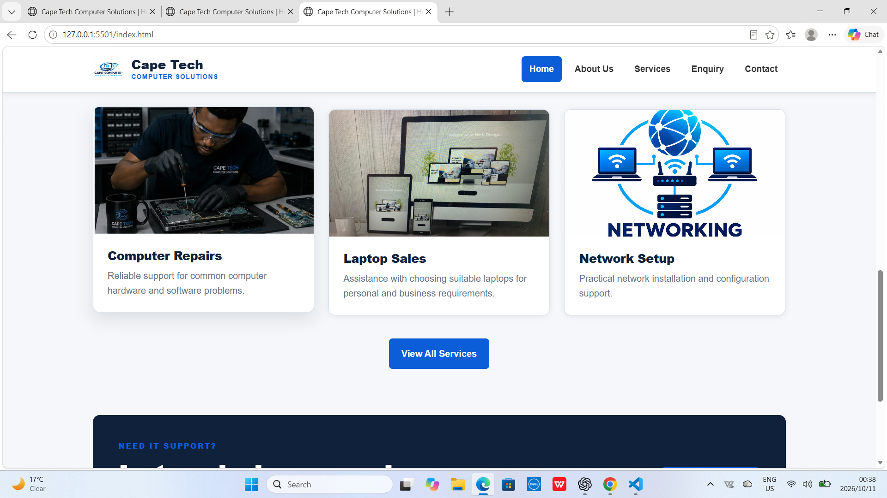
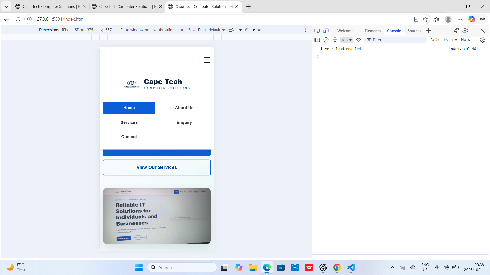
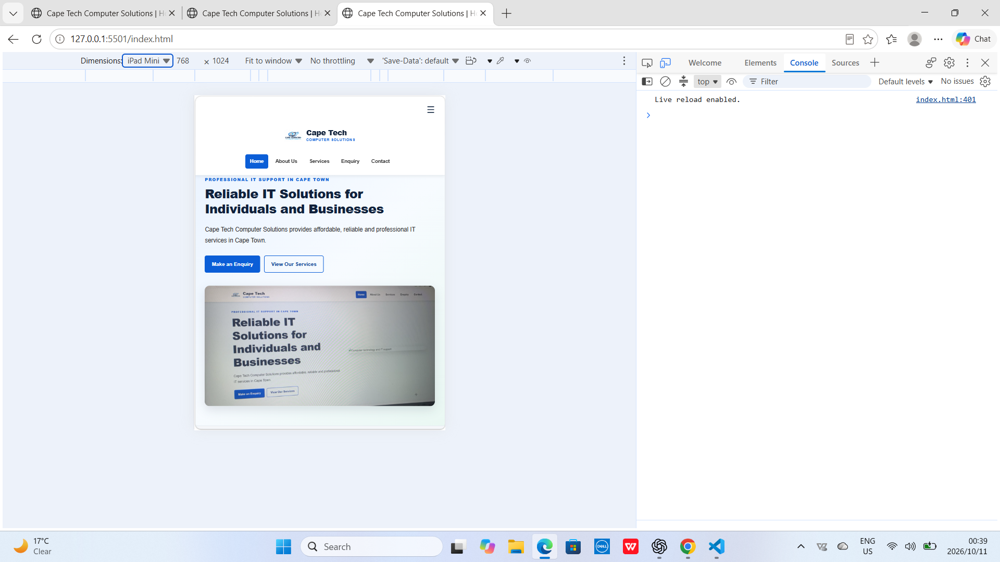

# Cape Tech Computer Solutions

## 1. Project Overview

Cape Tech Computer Solutions is a website project for an IT support
company based in Cape Town, South Africa.

The website provides information about the company, its IT services,
and how customers can make enquiries or contact the business.

The website is designed to be professional, accessible, responsive,
and easy to navigate.

## 2. Organisation Overview

### Mission

Our mission is to provide affordable, reliable, and professional IT
support to individuals and businesses in Cape Town.

### Vision

Our vision is to become a trusted IT support provider known for
quality service, customer satisfaction, and reliable technology
solutions.

### History

Cape Tech Computer Solutions is presented as an IT support business
serving individuals and businesses in Cape Town.

## 3. Project Goals and Objectives

The main goal is to develop a professional website that presents
the company's services and makes it easy for visitors to contact
the business.

### Objectives

- Present information about the company.
- Display the IT services offered.
- Allow visitors to submit enquiries.
- Provide contact information.
- Create a responsive layout for desktop, tablet, and mobile devices.
- Improve navigation and usability.
- Use external CSS for consistent styling.
- Use JavaScript where interactive functionality is required.

### Key Performance Indicators (KPIs)

- All navigation links open the correct pages.
- All required pages load without errors.
- Images display correctly.
- The website works on desktop, tablet, and mobile screens.
- Forms validate required fields.
- Visitors can easily find the enquiry and contact information.

## 4. Current Analysis

The project feedback identified several areas requiring improvement:

- The project proposal needed more detail.
- The README needed to match the actual project.
- CSS and JavaScript files needed to exist at the paths used by HTML.
- An uploaded image needed to be included on a webpage.
- More descriptive Git commits were required.
- Code comments were needed to improve readability.

The website structure and files have been updated to address the
relevant technical issues.

## 5. Website Pages

### Home
Introduces Cape Tech Computer Solutions and highlights its main services.

### About Us
Provides information about the organisation, its mission, and its vision.

### Services
Presents the IT services offered by the business.

### Enquiry
Allows visitors to provide information about their service requirements.

### Contact
Provides contact details and a way for visitors to get in touch.

## 6. Design and User Experience

The website uses a clean and professional design suitable for an
IT support business.

### Design choices

- Blue and white colour palette.
- Clear headings and readable typography.
- Consistent navigation across pages.
- Buttons with hover and focus states.
- Service cards to organise information.
- Responsive images.
- Flexible layouts using CSS Flexbox and Grid.

### Accessibility and usability

- Descriptive alternative text for meaningful images.
- Labels for form fields.
- Clear navigation links.
- Visible keyboard focus states.
- Sufficient spacing between interactive elements.

## 7. Technical Requirements

### Technologies

- HTML5
- CSS3
- JavaScript
- Visual Studio Code
- Git and GitHub
- A modern web browser

### Project structure

Cape-Tech/
├── index.html
├── about.html
├── services.html
├── enquiry.html
├── contact.html
├── css/
│   └── style.css
├── js/
│   └── script.js
├── images/
│   ├── logo.png
│   ├── hero.jpg
│   ├── computer-repair.jpg
│   ├── laptop.jpg
│   ├── networking.jpg
│   └── cybersecurity.jpg
├── screenshots/
└── README.md

## 8. Responsive Design and Testing

The website uses responsive CSS to adapt to different screen sizes.

Testing should include:

- Desktop: 1366px wide.
- Tablet: 768px wide.
- Mobile: 375px wide.

### Testing checklist

- [ ] Home page displays correctly.
- [ ] All navigation links work.
- [ ] All images load correctly.
- [ ] CSS stylesheet loads correctly.
- [ ] JavaScript loads correctly.
- [ ] Forms display and validate correctly.
- [ ] No horizontal scrolling on mobile.
- [ ] Buttons and links are usable with a keyboard.
- [ ] All five pages have been checked.

## 9. Project Timeline

| Task | Planned activity |
|---|---|
| Stage 1 | Review the assignment brief and feedback. |
| Stage 2 | Plan the website structure and content. |
| Stage 3 | Create the HTML pages. |
| Stage 4 | Develop the external CSS stylesheet. |
| Stage 5 | Add images and JavaScript functionality. |
| Stage 6 | Test responsiveness and navigation. |
| Stage 7 | Update documentation and README. |
| Stage 8 | Commit changes and prepare submission. |

The actual dates and completion status should be added according
to the work completed.

## 10. Budget

This is an academic website project developed using existing
development tools.

| Item | Estimated cost |
|---|---:|
| Visual Studio Code | R0 |
| HTML, CSS and JavaScript | R0 |
| Git and GitHub | R0 for basic use |
| Existing computer and internet | Existing resources |
| Domain and hosting | Not included in this estimate |

The budget excludes any optional paid domain, hosting, or commercial
assets.

## 11. Images and Assets

Images are stored in the `images/` directory.

Each image reference in the HTML must match the actual filename
and extension.

Meaningful images should include descriptive alternative text.

## 12. Changelog

### 18 September 2026 — Part 2 Improvements

#### 1. Image Integration
- **Problem:** The Part 1 feedback indicated that the uploaded image was not used on any webpage.
- **Why:** Images improve the website's appearance and help visitors understand the services offered.
- **Fix:** The image was added to the appropriate webpage, and the image path was checked to ensure that it displayed correctly.

#### 2. Website Styling and Responsive Design
- **Problem:** The Part 1 feedback indicated that the website had no external CSS stylesheet and lacked responsive styling.
- **Why:** Consistent styling and responsive layouts improve readability and usability across desktop, tablet, and mobile devices.
- **Fix:** The external CSS stylesheet was created and used to style the website, including typography, colours, layout, and responsive adjustments.

#### 3. Services Page Consistency
- **Problem:** The Services page needed to match the design of the other website pages.
- **Why:** A consistent design improves navigation and provides a professional user experience.
- **Fix:** The Services page was adjusted to follow the same visual style as the other pages.

#### 4. README Documentation
- **Problem:** The Part 1 feedback indicated that the README was empty and lacked project information and a changelog.
- **Why:** The README is required to document the website, its structure, and the improvements made.
- **Fix:** The README was updated with project documentation and a changelog based on the Part 1 feedback.

#### 5. References and AI Disclosure
- **Problem:** The Part 1 feedback identified incomplete references and missing AI-use disclosure.
- **Why:** Proper referencing acknowledges the resources used and supports academic integrity.
- **Fix:** References were reviewed and prepared using the Harvard (IIE) format. An AI-use disclosure was added in accordance with the assignment requirements.

#### 6. Mobile Navigation
- **Problem:** The Part 1 feedback indicated that the website lacked responsive navigation.
- **Why:** Mobile users need a navigation menu that works on smaller screens.
- **Fix:** A burger menu was added to improve navigation on mobile devices.

## 13. Known Limitations

- Enquiry and contact forms may require a backend service to send
  messages.
- Contact details must be verified before the website is published.
- Final browser and device testing must be completed before submission.

## 14. References
Mozilla Developer Network (MDN) (n.d.). HTML: HyperText Markup Language. [Online]. Available at: https://developer.mozilla.org/en-US/docs/Web/HTML [Accessed 18 September 2026].

Mozilla Developer Network (MDN) (n.d.). CSS: Cascading Style Sheets. [Online]. Available at: https://developer.mozilla.org/en-US/docs/Web/CSS [Accessed 18 September 2026].

Mozilla Developer Network (MDN) (n.d.). JavaScript. [Online]. Available at: https://developer.mozilla.org/en-US/docs/Web/JavaScript [Accessed 18 September 2026].

Mozilla Developer Network (MDN) (n.d.). Basic concepts of flexbox. [Online]. Available at: https://developer.mozilla.org/en-US/docs/Web/CSS/CSS_flexible_box_layout/Basic_concepts_of_flexbox [Accessed 18 September 2026].

Artificial Intelligence

OpenAI (2026). ChatGPT. [Online]. Available at: https://chatgpt.com/ [Accessed 18 September 2026].

AI Use Disclosure: ChatGPT was used to assist with understanding assessment feedback, troubleshooting website code, improving HTML and CSS, and preparing project documentation. AI-generated suggestions were reviewed and adapted during development. The final submission should reflect the student's actual work and comply with the AI-use requirements in the WEDE5020 POE assessment annexure.
## Responsive Design Screenshots

### Desktop View

### Mobile View

### Tablet View

